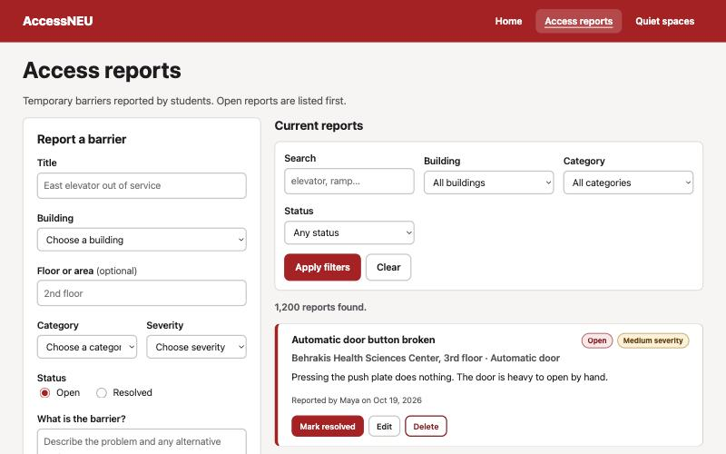

# AccessNEU

A community-maintained campus accessibility and quiet-space reliability board
for Northeastern students.



## Authors

- **Drashti Bhavsar**: Access reports (`access_reports` collection, Express
  routes, validation, frontend page)
- **Hard Gondaliya**: Quiet spaces (`quiet_spaces` collection, Express routes,
  validation, frontend page)

## Class

[CS 5610 Web Development, Northeastern University](TODO-add-class-page-link),
taught by Prof. John Alexis Guerra Gómez.

## Links

- Live app: [Live App](https://access-neu.onrender.com/index.html)
- Demo video: TODO-add-video-link
- Slides: [Google Slides](https://docs.google.com/presentation/d/1VDbcAOcNWCjDYKrmIQnBvj7GHDdyMgXGWpEm_rsC-Ig/edit?usp=sharing)
- Design document: [docs/DESIGN.md](docs/DESIGN.md)

## Project objective

Students often find out that an elevator is broken or an accessible entrance is
locked only after they arrive, and students who need a quiet, low-stimulation
place to study have no shared list of where to go. AccessNEU lets students:

1. **Report access barriers**: create, browse, filter, edit, resolve and delete
   reports about broken elevators, blocked ramps, locked entrances and similar
   problems.
2. **Maintain a quiet-space guide**: add, browse, filter, edit and delete quiet
   and sensory-friendly study spaces, with noise level, lighting, hours and
   accessibility features.

The two features use separate MongoDB collections and work independently.

## How to use

- **Access reports** (`/reports.html`): filter by building, category, status or
  keyword. Fill in _Report a barrier_ to add one. On a report, select _Mark
  resolved_, _Edit_ or _Delete_.
- **Quiet spaces** (`/spaces.html`): filter by building, noise level, lighting
  or feature. Fill in _Add a quiet space_ to add one. Select _Edit_ or _Delete_
  on a listing.

The home page has the same instructions.

## Tech stack

- Frontend: HTML5, CSS3, vanilla JavaScript ES6 modules, Fetch API
  (client-side rendering, no frameworks)
- Backend: Node.js, Express 5, ES modules (no `require`)
- Database: MongoDB with the official `mongodb` driver (no Mongoose)
- Tooling: ESLint, Prettier

## Project structure

```
server.js                  Express app: static files, API routes, error handler
backend/
  constants.js             Allowed buildings, categories, noise levels...
  db/connection.js         MongoDB connector (one shared client)
  db/accessReportsDB.js    CRUD for access_reports
  db/quietSpacesDB.js      CRUD for quiet_spaces
  db/pagination.js         Paging and search helpers
  routes/                  One Express router per collection, plus /api/meta
  validation/              Input validation per collection
frontend/
  index.html               Home page with instructions
  reports.html             Access reports page
  spaces.html              Quiet spaces page
  css/                     One CSS module per component or page
  js/shared/               API client, DOM helpers, form, dialog, pagination
  js/reports/              Access reports page modules
  js/spaces/               Quiet spaces page modules
scripts/seed.js            Loads 1,500 fictional sample records
docs/                      Design document, mockups, screenshot
```

## Build and run locally

Requirements: Node.js 20 or newer and a MongoDB database (local or
[MongoDB Atlas](https://www.mongodb.com/atlas)).

```bash
git clone TODO-add-repo-url
cd access-neu
npm install
cp .env.example .env      # then set MONGO_URI to your connection string
npm run seed              # optional: 1,200 reports + 300 spaces of sample data
npm start                 # http://localhost:3000
```

Other scripts:

| Command                | What it does                     |
| ---------------------- | -------------------------------- |
| `npm run dev`          | Start with auto-restart on edits |
| `npm run lint`         | Run ESLint                       |
| `npm run format`       | Format all files with Prettier   |
| `npm run format:check` | Check formatting                 |

The seed script **replaces** everything in the two collections. The sample
records are fictional and only there for demonstration.

## Deployment (Render)

1. Create a free MongoDB Atlas cluster, a database user, and allow access from
   `0.0.0.0/0` (Render has no fixed IP on the free tier).
2. On Render, create a **Web Service** from this repository.
   Build command: `npm install`. Start command: `npm start`.
3. Add the environment variables `MONGO_URI` and `DB_NAME=accessneu`.
4. Run `npm run seed` once from your machine with `MONGO_URI` pointing at Atlas.

Credentials live only in `.env` (ignored by git) and in Render's environment
settings.

## Use of AI

TODO: describe how you used generative AI tools (for example Claude Code) while
building this project, as required by the course policy.

## License

[MIT](LICENSE)
