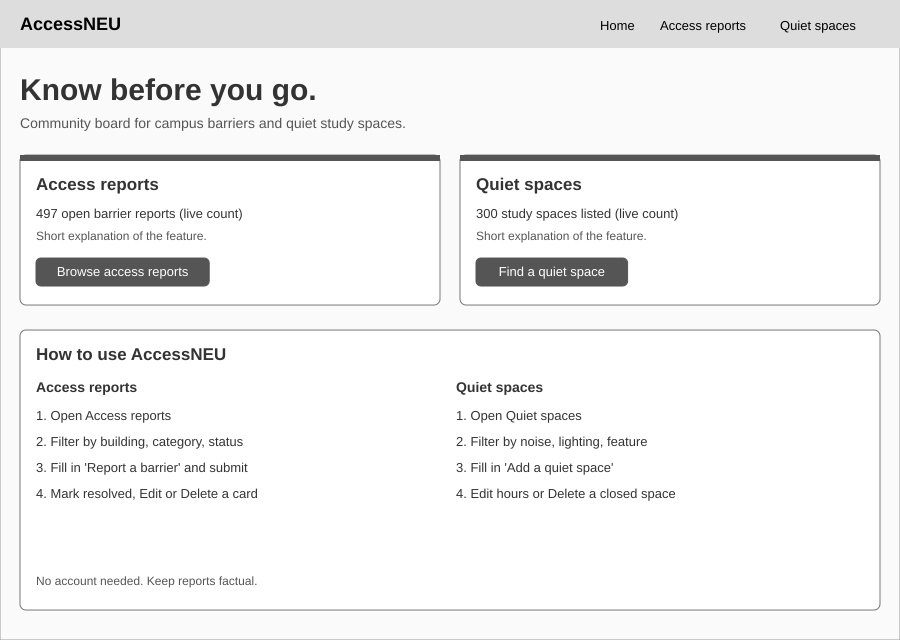
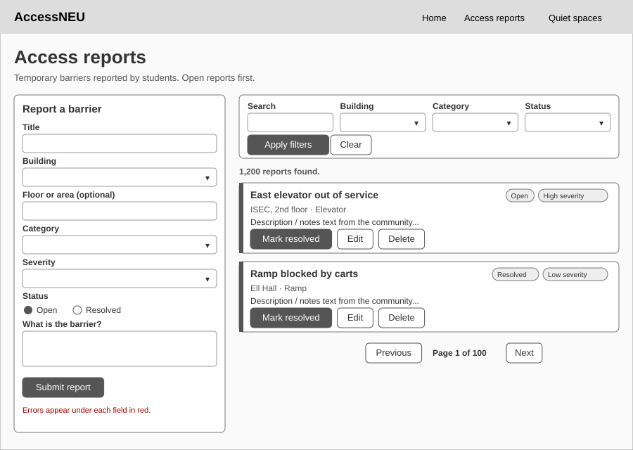
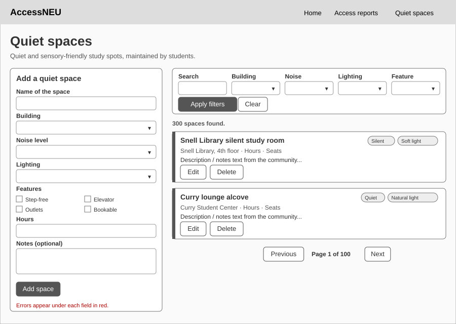

# AccessNEU Design Document

**Team:** Drashti Bhavsar and Hard Gondaliya
**Course:** CS 5610 Web Development, Northeastern University

## 1. Project description

AccessNEU is a community-maintained campus accessibility and quiet-space
reliability board for Northeastern students.

Students often find out that an elevator is broken, an accessible entrance is
locked or a ramp is blocked only when they arrive. For a wheelchair user, a
student on crutches or someone carrying heavy equipment, that can mean a long
detour or a missed class. In the same way, students who need a quiet,
low-stimulation place to study waste time walking between buildings looking for
one.

AccessNEU gives students two independent tools:

| Feature        | Collection       | Owner           | What users can do                                                                                 |
| -------------- | ---------------- | --------------- | ------------------------------------------------------------------------------------------------- |
| Access reports | `access_reports` | Drashti Bhavsar | Report a temporary barrier, browse and filter reports, edit them, mark them resolved, delete them |
| Quiet spaces   | `quiet_spaces`   | Hard Gondaliya  | Add a quiet or sensory-friendly study space, filter by noise, lighting and features, edit, delete |

Each feature has its own MongoDB collection, Express router, validation module,
frontend page, JavaScript modules and CSS file, so either one works without the
other.

**Tech stack:** HTML5, CSS3, vanilla JavaScript (ES6 modules, Fetch API) on the
client; Node.js and Express on the server; MongoDB through the official Node.js
driver. No Mongoose, no template engines and no frontend frameworks.

## 2. User personas

### Maya Chen: graduate student who uses a wheelchair

- **Age / program:** 26, MS in Bioengineering, lives off campus.
- **Context:** Has back-to-back labs in ISEC and classes in Snell Engineering.
  Relies on elevators and automatic doors.
- **Frustration:** Twice this semester she arrived at a building and found the
  elevator out of service, with no notice anywhere online.
- **Goal:** Check before leaving home whether the buildings on her route have
  any open barriers, and warn others when she finds one.
- **Uses:** Access reports (filter by building and status, create reports).

### Jordan Alvarez: commuter student who needs quiet space

- **Age / program:** 21, third-year Computer Science, commutes 50 minutes by
  train.
- **Context:** Has two-hour gaps between classes and no dorm room to go back to.
  Has ADHD and finds bright, noisy rooms hard to focus in.
- **Frustration:** Snell Library's popular floors are packed, and he doesn't
  know about the quieter rooms in other buildings.
- **Goal:** Find a silent, softly lit space near his next class that is open
  right now.
- **Uses:** Quiet spaces (filter by building, noise level and lighting).

### Priya Nair: student who likes to help others

- **Age / program:** 19, second-year Health Science, peer mentor in her
  residence hall.
- **Context:** Walks across campus all day and notices problems: blocked ramps,
  broken door buttons, a lounge that just became a bookable quiet room.
- **Frustration:** Reporting a problem to facilities doesn't tell other students
  about it.
- **Goal:** Share what she sees quickly and keep the information accurate:
  marking things resolved once they are fixed.
- **Uses:** Both features (create, update and resolve).

## 3. User stories

### Access reports (Drashti Bhavsar)

1. **Create a report.** _As a campus user, I want to create a report about an
   accessibility barrier so other students can plan before visiting that
   location._
   Priya is walking past Ell Hall and sees delivery carts parked across the
   ramp. She opens AccessNEU on her phone, chooses **Ell Hall**, the
   **Ramp** category and **Medium** severity, writes one sentence about the
   carts and submits. The report appears at the top of the list right away.

2. **Browse and filter reports.** _As a campus user, I want to browse and filter
   reports by location, category and status so I can find relevant
   information._
   Before leaving home, Maya filters by **ISEC** and status **Open**. She sees
   that the east elevator was reported broken this morning, so she plans to
   enter from the west side.

3. **Edit or resolve a report.** _As a report author, I want to edit a report or
   mark it resolved so its information remains accurate._
   The next day Priya walks by Ell Hall again and the ramp is clear. She finds
   her report and selects **Mark resolved**. It moves below the open reports
   with a green "Resolved" badge and the date it was fixed. Later she notices
   she wrote the wrong floor and uses **Edit** to correct it.

4. **Delete a report.** _As a report author, I want to delete an incorrect or
   duplicate report so misleading information is removed._
   Maya sees that two people reported the same broken door button. She selects
   **Delete** on the duplicate, confirms in the dialog, and the list updates.

### Quiet spaces (Hard Gondaliya)

1. **Add a space.** _As a student, I want to add a quiet or sensory-friendly
   study space so other students can discover it._
   Jordan discovers a silent graduate lounge on the third floor of Richards
   Hall. He fills in the **Add a quiet space** form: noise level **Silent**,
   lighting **Soft**, features **Power outlets** and **Low foot traffic**, hours
   and seat count, and submits it.

2. **Browse and filter spaces.** _As a student, I want to browse and filter
   spaces by noise level, lighting, location and accessibility features so I
   can find a suitable environment._
   Maya needs a quiet place to study between labs that she can reach without
   steps. She filters by feature **Step-free access** and noise level
   **Quiet**, and finds two options in ISEC.

3. **Update a space.** _As a contributor, I want to update a space's hours or
   accessibility details so the guide remains useful._
   The library changes its weekend hours. Priya selects **Edit** on the space,
   updates the hours to "24/7 with Husky Card" and saves.

4. **Delete a space.** _As a contributor, I want to delete a closed or
   incorrectly listed space so outdated information is removed._
   A lounge in Curry is converted into offices. Jordan deletes the listing so
   nobody walks there for nothing.

## 4. Design mockups

The mockups below are low-fidelity wireframes made before building the pages.
The final pages follow the same layout: the form on the left, filters and
results on the right (stacked on phones).

### Home page

### Access reports page

### Quiet spaces page

## 5. Data model

### `access_reports`

| Field          | Type         | Notes                                                      |
| -------------- | ------------ | ---------------------------------------------------------- |
| `title`        | string       | 5-100 characters                                           |
| `location`     | string       | One of the campus buildings in `backend/constants.js`      |
| `floor`        | string       | Optional                                                   |
| `category`     | string       | elevator, ramp, entrance, automatic door, restroom, ...    |
| `severity`     | string       | low, medium, high                                          |
| `status`       | string       | open, resolved                                             |
| `description`  | string       | 10-1000 characters                                         |
| `reporterName` | string       | Optional                                                   |
| `createdAt`    | date         | Set by the server                                          |
| `updatedAt`    | date         | Set by the server                                          |
| `resolvedAt`   | date or null | Set when status changes to resolved, cleared when reopened |

### `quiet_spaces`

| Field        | Type     | Notes                                                 |
| ------------ | -------- | ----------------------------------------------------- |
| `name`       | string   | 3-80 characters                                       |
| `building`   | string   | One of the campus buildings                           |
| `floor`      | string   | Optional                                              |
| `noiseLevel` | string   | silent, quiet, low chatter                            |
| `lighting`   | string   | natural, soft, bright, adjustable                     |
| `features`   | string[] | step-free access, elevator access, power outlets, ... |
| `capacity`   | number   | 1-500 seats                                           |
| `hours`      | string   | Free text, e.g. "Mon-Fri 8am-10pm"                    |
| `notes`      | string   | Optional                                              |
| `addedBy`    | string   | Optional                                              |
| `createdAt`  | date     | Set by the server                                     |
| `updatedAt`  | date     | Set by the server                                     |

## 6. API

| Method | Route              | Purpose                                                                     |
| ------ | ------------------ | --------------------------------------------------------------------------- |
| GET    | `/api/meta`        | Allowed values for dropdowns (buildings, categories...)                     |
| GET    | `/api/reports`     | List reports. Query: location, category, status, severity, q, page, limit   |
| GET    | `/api/reports/:id` | One report                                                                  |
| POST   | `/api/reports`     | Create a report                                                             |
| PUT    | `/api/reports/:id` | Update a report (including marking it resolved)                             |
| DELETE | `/api/reports/:id` | Delete a report                                                             |
| GET    | `/api/spaces`      | List spaces. Query: building, noiseLevel, lighting, feature, q, page, limit |
| GET    | `/api/spaces/:id`  | One space                                                                   |
| POST   | `/api/spaces`      | Create a space                                                              |
| PUT    | `/api/spaces/:id`  | Update a space                                                              |
| DELETE | `/api/spaces/:id`  | Delete a space                                                              |

Invalid input returns `400` with an `errors` object keyed by field name, which
the forms show under each field.

## 7. Accessibility decisions

Since the app is about accessibility, the interface tries to practice it:

- Real `<button>`, `<form>`, `<label>`, `<fieldset>` and `<dialog>` elements, so
  everything works with a keyboard and a screen reader.
- A "Skip to main content" link and visible focus outlines.
- Field errors are shown as text next to each field (not only by color), and
  focus moves to the first invalid field.
- Status messages use an `aria-live` region.
- Card buttons have labels such as "Delete: Elevator out of service" so screen
  reader users know which item a button acts on.
- Text and badge colors meet WCAG AA contrast, and the layout works at 375px
  width.
